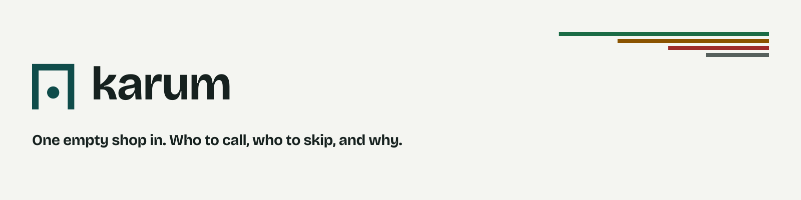

<picture>
  <source media="(prefers-color-scheme: dark)" srcset="assets/brand/social/readme-banner-1600x400-dark.png">
  
</picture>

<div align="center">

[](LICENSE)
[](https://flutter.dev)
[](https://dart.dev)
[](https://devpost.com)
[](https://karum-512016.web.app)

</div>

---

## Product

**Karum** is an agentic B2B retail distribution and site-selection platform built for the **Qloo Agentic Hackathon 2026**. Operated by emerging and scaling consumer brands (Food & Beverage, Craft Spirits, Specialty CPG, Apparel, Lifestyle), Karum closes the gap between a brand and physical retail.

Given a brand identity — or a composite cultural vibe — and a target city, Karum queries Qloo's Taste Graph to decode the cultural and demographic DNA of every block and venue. It tells a brand **which independent stores, bars, and cafes ("doors") to pitch**, **where to open a flagship store or weekend pop-up**, **which non-competing boutiques to partner with**, **which accounts to skip**, then audits each venue's live menu for competitors, calculates an optimized field-sales route, and drafts hyper-personalized B2B sales scripts and displacement battlecards.

> **Hosted demo:** https://karum-512016.web.app  
> **Public client link:** `<!-- TODO: insert public karum-client URL (Firebase Hosting / Devpost) -->`  
> *`make demo-refresh` in `karum-infra` builds and deploys this repo.*

---

## Karum at a glance — the five-repo layout

Karum is split into five decoupled repositories so the UI, gateway, taste engine, and AI engine can be built in parallel.

<table>
  <tr>
    <td><b>Repo</b></td>
    <td><b>Role</b></td>
    <td><b>Contains / owns</b></td>
  </tr>
  <tr>
    <td><b><code>karum-infra</code></b><br><sup>Shared platform</sup></td>
    <td>Protos, laptop run path, demo VM</td>
    <td>Protobuf contracts (<code>karum.taste.v1</code>, <code>karum.agent.v1</code>), docker-compose local stack, Cloud Run manifests, Makefile, CI, fixture pack</td>
  </tr>
  <tr>
    <td><b><code>karum-client</code></b> ← this repo<br><sup>Frontend</sup></td>
    <td>Flutter UI (web / desktop)</td>
    <td>Judge-ready Flutter web UI; desktop runs the same screens</td>
  </tr>
  <tr>
    <td><b><code>karum-server</code></b><br><sup>Gateway</sup></td>
    <td>Go + Gin API gateway</td>
    <td>REST/SSE to the client, gRPC to <code>service-taste</code> + <code>service-ai</code>, Google Places/Routes, PDF run-sheets and site briefs</td>
  </tr>
  <tr>
    <td><b><code>karum-service-taste</code></b><br><sup>Qloo engine</sup></td>
    <td>Qloo integration, caching, taste scoring</td>
    <td>Python FastAPI + gRPC; all Qloo Taste Graph calls, seed/tag/door/heatmap/compare resolution, Redis caching by parameter hash</td>
  </tr>
  <tr>
    <td><b><code>karum-service-ai</code></b><br><sup>AI engine</sup></td>
    <td>Vertex AI, search grounding, pitch drafting</td>
    <td>Python FastAPI + gRPC; Vertex AI Gemini + Google Search Grounding, menu audit, SKU choice, pitch script, displacement battlecard, LLM-only baseline</td>
  </tr>
</table>

System flow:

```
┌──────────────┐        POST /api/v1/scout        ┌─────────────────┐
│ Flutter      │ ─────────────────────────────────►│ Go + Gin        │
│ client       │                                    │ gateway         │
│ (karum-client)│ ◄──────────────────────────────── │ (karum-server)  │
└──────────────┘           trace events + payload   └────────┬────────┘
                                                             │
                             ┌───────────────┬──────────────┴───────────────┐
                             ▼               ▼                              ▼
                    ┌──────────────┐  ┌──────────────┐          ┌──────────────┐
                    │ service-taste│  │ service-ai   │          │ Google       │
                    │ (Qloo engine)│  │ (Vertex AI)  │          │ Places /     │
                    └──────┬───────┘  └──────┬───────┘          │ Routes API   │
                           │                 │                   └──────────────┘
                           ▼                 ▼
                    ┌──────────────┐  ┌──────────────┐
                    │ Qloo API     │  │ Vertex AI +  │
                    │ (taste graph)│  │ Search       │
                    └──────────────┘  │ Grounding    │
                                     └──────────────┘
```

---

## What the agent can do (key features)

| Feature | What it does |
|---|---|
| **Seed builder** | Brand input, composite vibe seed, city, mode, radius, category tags, SKUs. Ambiguous cities ask for a point; a seed is confirmed against resolved entity ids before `POST /api/v1/scout`. |
| **Live trace** | Server-Sent Events stages as the pipeline runs across `service-taste` → `server` → `service-ai`, with a polling fallback when the stream drops. |
| **Map** | Google Maps basemap (`google_maps_flutter`) with door pins, skip pins, and locality polygons from the same Qloo payload the board shows. Falls back to CARTO tiles without a Maps key. |
| **Door board** | Ranked doors with the gateway's reason codes and reason detail, plus an LLM-only baseline for comparison. The evidence drawer opens every score's inputs and cites the Qloo calls behind them. |
| **Pitch** | Shopkeeper script, displacement battlecard, recommended SKU, mode-specific paragraph, run-sheet and site-brief actions. |
| **Provenance everywhere** | Each number carries a source badge (Qloo fact, Google fact, model inference, ungrounded LLM). The client renders the gateway's rank and reasons as-is — no client-side re-sorting, no re-derived scores. |

It also carries the brand foundation (`lib/src/theme/brand_tokens.dart`, `app_theme.dart`), the judge sign-in flow, and the documented keyboard path and contrast table in [`ACCESSIBILITY.md`](ACCESSIBILITY.md).

---

## What makes it Qloo-powered

Qloo is the taste graph — **Karum cannot work without it**. Remove Qloo and the product collapses into a generic LLM answer like "open a café or a plant shop."

The Flutter client never calls Qloo directly. The `X-Api-Key` stays server-side inside `service-taste`, and all 10,000 hackathon requests/month are cached by parameter hash in Redis so prewarmed and repeated runs never exhaust the quota.

### What Qloo enables that an LLM or web search cannot

- **Cross-domain Brand/Seed → Places** — ranked venues whose patrons share behavioral affinity with the brand, scoped to a city point and radius.
- **`urn:tag` lifestyle descriptors** — readable cultural tags ("craft cocktails", "indie rock", "sustainable design") that define each venue's crowd.
- **`urn:heatmap` spatial cells** — affinity intensity per block for flagship and pop-up site scouting.
- **`urn:demographics` audience skew** — age/gender alignment per venue, mapped onto the brand's target cohort.
- **`/v2/analysis/compare` overlap** — quantifies why the emerging brand fits a venue better than the incumbent competitor detected on its menu.
- **`feature.explainability=true` evidence** — every recommendation decomposes into named contributing entities (per-result `signal.interests.entities` weights), shown in the "How We Know" evidence drawer — not inferred by the model.

### Transparent door scoring

Every door score is a composite of three 0–1 sub-scores, displayed as 0–100:

> **S<sub>door</sub> = 0.50 · A<sub>taste</sub> + 0.30 · O<sub>shelf</sub> + 0.20 · D<sub>demo</sub>**

| Sub-score | Meaning | Source |
|---|---|---|
| **A<sub>taste</sub>** | Cultural affinity fit between the brand seed and the venue | Qloo affinity, percentile within the shortlist |
| **O<sub>shelf</sub>** | Shelf / menu opportunity | Vertex AI Search Grounding live-menu audit |
| **D<sub>demo</sub>** | Demographic / locality alignment | Venue age buckets + neighborhood heatmap intensity |

A **skip gate** (outside the composite) pushes low-affinity or oversaturated venues into **"Doors to Skip"** — negative space that proves the agent says no as often as it says yes.

---

## Run path

Requires the **Flutter SDK** (see the version pin in [`karum-infra`](https://github.com/karum-labs/karum-infra)).

The gateway base URL is supplied with `--dart-define`. On the laptop, start the stack from `karum-infra` with `make local`. That opens this app against the local gateway. To start the client on its own once the gateway is already up:

```bash
flutter run -d chrome --dart-define=GATEWAY_URL=http://127.0.0.1:8080
```

If `GATEWAY_URL` is omitted, the app defaults to `http://localhost:8080`.

Share links point at the running web app, not at the gateway's JSON API. Web builds use the browser origin and the hash route automatically; a desktop build has no browser origin, so set `--dart-define=PUBLIC_APP_URL=https://karum-512016.web.app` to produce a shareable link.

The login screen's hackathon banner follows `SHOW_JUDGES_BANNER`. It is on in debug and profile, and off in a release build, unless you pass `--dart-define=SHOW_JUDGES_BANNER=true` or `false`. The banner's **Open demo** button needs the gateway running with `HACKATHON_MODE=true`.

**Previewing `build/web` without the stack:** the landing screen fetches `GET /health` on load, so served from a plain static file server there is no gateway behind it and `/health` answers 404 — the screen shows its gateway-unavailable state, which is expected rather than a bug. To preview the happy path, run `make local` in `karum-infra`, or serve `build/web` from something that answers `/health` with the mode you want to see.

---

## What else to add before the hackathon submission

- [ ] Paste the real public karum-client URL (Firebase Hosting / Devpost demo link) in place of the TODO placeholder in the **Product** section.
- [ ] Devpost submission mapped to the four judging criteria — submit by Oct 29, 24 hours ahead of the Oct 30, 2026 11:45pm EDT deadline.
- [ ] Keep the public build no-login with 1-click presets (Austin "Sola Yuzu Mezcal" wholesale, Brooklyn flagship + collab, Mumbai Colaba cacao/coffee) prewarmed so judges see a live run in under ~1s.
- [ ] Optional but recommended: a short demo video walking the 3-minute script — seed → live trace → door card + evidence drawer → "Doors to Skip" → LLM-only baseline toggle → pitch & run-sheet → Brooklyn heatmap.
- [ ] Verify the MIT licence is visible in the GitHub About section of all five repos (open-source requirement).
- [ ] Confirm Cloud Run services and the prewarmed cache stay live through the judging window (Nov 2–16) and to Nov 23.
- [ ] Latency check: < 8s for a live run, < 1s for stored presets.

---

## Development

```bash
flutter analyze   # static analysis (flutter_lints)
flutter test      # widget tests
flutter pub get   # fetch dependencies
```

## Ownership

Karum is a two-person build (record: [`DECISIONS.md`](https://github.com/karum-labs/karum-infra/blob/main/DECISIONS.md)). **Side A** owns taste, score, agent, and eval; **side B** owns UI, map, drafts, deploy, and Devpost. This repo is **side B** — UI, map, and the deliverable actions. It renders the server's rank and reason codes as-is: no client-side re-sorting, no re-derived scores.

## Licence

MIT. See [`LICENSE`](LICENSE).

---

<p align="center">
  Built for the <b>Qloo Agentic Hackathon 2026</b> · <a href="https://karum-512016.web.app">Live demo</a> · <b>MIT Licence</b>
</p>
