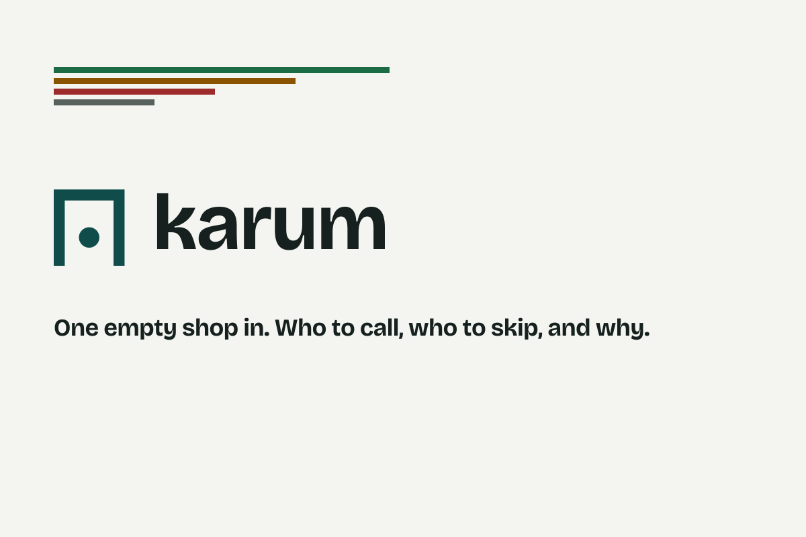

<picture>
  <source media="(prefers-color-scheme: dark)" srcset="assets/brand/social/readme-banner-1600x400-dark.png">
  
</picture>

### Karum — the expansion agent for consumer brands

Tell it a brand and a city. It tells you which stores to pitch, where to open, who to partner with, and which doors to skip.

---

## Watch the demo

**▶ [Watch the 3-minute walkthrough on Vimeo](https://vimeo.com/1241448615)**

---

## The problem

Emerging brands guess where to sell. A field rep walks into ten stores a day, and half of them have customers who will never buy the product. The brand burns time and money, and the store misses a product its customers would have loved.

The data to fix this already exists. Qloo's Taste Graph can answer *"where do the people who love this brand actually go?"* — not just *"what's popular on Yelp?"* Karum turns that answer into a day's work for a sales team.

## What Karum does

You give Karum a brand — or a mix of reference brands, music genres, and lifestyle tags that describe your customers — and a target city. Karum then:

- **Finds the right stores to pitch.** Ranks independent bars, cafes, and shops whose customers share your brand's tastes.
- **Finds where to open.** Points to the blocks and neighborhoods where your target customers are concentrated, for a flagship store or a weekend pop-up.
- **Finds partners.** Suggests non-competing shops — bookstores, galleries, studios — whose customers match yours, for joint events.
- **Checks what's on the shelf right now.** Reads each store's live menu or shelf for competing and complementary products.
- **Tells you where *not* to go.** A "Doors to Skip" list flags popular stores that don't fit your brand or already carry too many competitors.
- **Writes the pitch.** A tailored script for each shopkeeper, the product most likely to sell there, and a battlecard against the competitor already on the shelf.
- **Plans the route.** The best driving order to visit every qualified store in a day.
- **Hands you the paperwork.** A field run-sheet or a site-selection brief, ready to export as a PDF.

Every piece of information is labeled with where it came from. If Karum can't find an answer, it says so instead of guessing.

## Try it yourself

**[karum-512016.web.app](https://karum-512016.web.app)** — no login. Open one of the one-click examples and watch a full run in about a second:

- **Sola** — a yuzu-mezcal aperitif scouting bars in **Austin**
- **Brooklyn** — a flagship-location scout and a brand-collaboration scout
- **Mumbai** — a cacao & coffee brand scouting doors in **Colaba**

## How it works, in four steps

1. **Describe the brand.** Pick a brand or build a cultural "vibe" from a few reference tags, then choose a city and a goal (pitch stores, open a location, or find partners).
2. **Read the city's taste.** Qloo ranks every candidate venue by how closely its customers match your brand, and highlights the neighborhoods where they cluster.
3. **Check the ground truth.** Google's AI reads each venue's live menu for competitors, Google Maps fills in addresses and the best route, and each store gets a single clear score.
4. **Walk in ready.** You get the ranked list, the stores to skip, a pitch and battlecard for each door, and a route for the day.

## Why Qloo is essential

Without Qloo, a regular AI just lists the most famous bars from travel blogs — with no idea whether their customers actually fit your brand. Qloo is what lets Karum tell a trendy-but-wrong store from a quietly perfect one.

Karum uses Qloo to understand each venue's crowd, to map where a brand's customers live across a city, to describe the culture of a neighborhood in plain tags, and to explain *why* each recommendation was made — so every suggestion traces back to real cultural data, not a guess.

## How the store score works

Every store gets one score from 0 to 100, combining three things:

> **Store score = 50% × Taste fit + 30% × Shelf opportunity + 20% × Demographic fit**

- **Taste fit** — how well the store's customers match your brand
- **Shelf opportunity** — how much room there is on the menu or shelf for your product
- **Demographic fit** — how well the store's customer age groups match your target customers

If the live menu can't be checked, that part is marked unknown and the score is recalculated from the rest. Stores that score too low, or that already carry four or more direct competitors, move to the skip list with a reason attached.

## Honest by design

Trust is the whole point of a tool that tells a brand where to spend its money, so honesty is built into Karum:

- **Every number cites its source** — Qloo fact, Google fact, AI inference, or your own input.
- **A missing answer is shown as missing,** never invented.
- **See the evidence.** An evidence drawer opens the exact signals behind any recommendation.
- **Compare against a plain AI.** A side-by-side view shows how a regular AI without Qloo gives generic tourist picks while Karum finds real customer fit.
- **It still works when parts fail.** If the menu check or the AI is unavailable, the store list still appears, clearly marked, rather than showing nothing.

## Built with

**Qloo Taste Graph** for cultural and demographic insight · **Google Vertex AI (Gemini) with Google Search** for live menu checks and pitch writing · **Google Maps** for locations and routing. The platform is open source under the MIT License, built by two people across a connected set of services.

This repository is the **Karum web app** — the screens judges and users see. The rest of the platform lives in [`karum-infra`](https://github.com/karum-labs/karum-infra), which also carries the setup and run instructions for developers.

## Licence

MIT — see [`LICENSE`](LICENSE).

---

  Built for the <b>Qloo Agentic Hackathon 2026</b> · <a href="https://karum-512016.web.app">Live demo</a> · <a href="https://vimeo.com/1241448615">Demo video</a>

